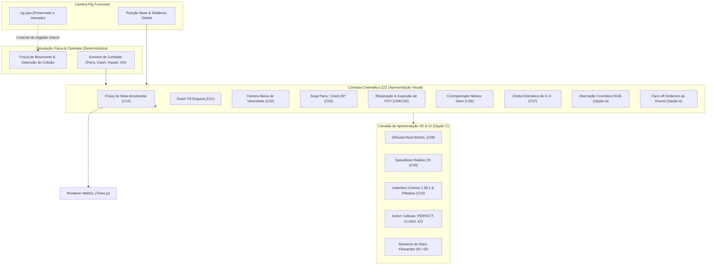

# Arenamon — Relatório de Auditoria Técnica & Overview Geral
## Sistema de Câmera Cinemática ZZZ & Expansão de Game Feeling (Opções A e C)

**Data:** 19 de Outubro de 2026  
**Repositório:** `https://github.com/Ziaker/Arenamon`  
**Branch Auditada:** `feat/camera-cinematica-zzz`  
**Commit Auditado:** [`37140bcfd645dba70ecde8ef8415212cad3ccf93`](https://github.com/Ziaker/Arenamon/commit/37140bcfd645dba70ecde8ef8415212cad3ccf93)  
**Ambiente Oficial:** `C:\Users\zerke\OneDrive\Área de Trabalho\Arenamon`  

---

## 1. Resumo Executivo & Overview Geral

Esta auditoria abrange tanto as **correções estruturais da 3ª rodada de auditoria independente** quanto a **expansão de game feeling (Opções A e C)** adicionada ao Combat Lab do Arenamon.

O sistema completo entrega uma experiência visual de ação estilo *Zenless Zone Zero (ZZZ)* sem ferir as regras determinísticas do jogo de luta, garantindo que o controle direcional do jogador permaneça inalterado e que todos os efeitos visuais sejam opcionais, configuráveis e com controles acessíveis em tempo real.



---

## 2. Overview de Tudo Que Foi Adicionado

### A. Efeitos Cinemáticos de Lente e Câmera (C01–C12 + Opção A)
| Identificador | Recurso | Descrição Técnica | Gatilho / Comportamento |
| :--- | :--- | :--- | :--- |
| **C01** | **Dutch Dodge Angle** | Inclinação lateral do horizonte em até ±10°. | Esquiva lateral (`C`). |
| **C02** | **Low-Speed Perspective** | Câmera baixa (*worm's-eye*) de velocidade. | Sprint ou aceleração de Tackle. |
| **C03** | **Lateral Snap** | Corte momentâneo lateral a 80° em perfil anime. | Defesa Perfeita (*Parry*) ou *Clash*. |
| **C04** | **Charge Breathing FOV** | Compressão gradual do FOV durante cargas. | Carga de projéteis ou Tackle. |
| **C05** | **Release FOV Punch** | Explosão súbita e retorno por mola no disparo. | Disparo de golpe carregado. |
| **C06** | **Meteor Contraplongée** | Ângulo de baixo para cima acompanhando queda vertical. | Salto alto com descida rápida em Tackle Slam. |
| **C07** | **KO Clímax Finisher** | Enquadramento dramático baixo e órbita suave de 24°. | K.O. do lutador derrotado (1x por round). |
| **C08** | **WebGL Silhouettes** | Troca atômica de materiais para branco puro e preto puro. | Impact frames de choques pesados. |
| **C09** | **Speedlines Radiais** | Linhas de velocidade convergindo para o ponto de colisão. | Impactos pesados, Meteor e K.O. |
| **C10** | **Dynamic Letterbox** | Faixas pretas e pillarbox automático para 2.39:1. | Momentos épicos e K.O. |
| **C11** | **Visual Bullet Time** | Fator de desaceleração de tempo estritamente visual. | Clímax de K.O. e parry. |
| **C12** | **Spring Inertia** | Mola amortecida que evita cortes secos de câmera. | Suavização global de todos os movimentos. |
| **Novo (Opção A)** | **Aberração Cromática RGB** | Dispersão óptica com separação de canais vermelho e ciano. | Disparado em parries, clashes, impactos pesados e K.O. |
| **Novo (Opção A)** | **Round Intro Face-off** | Plano rasante dinâmico nos primeiros 1.2s de combate. | Início de nova partida (`startMatch`). |

### B. Sistema de Feedback de Combate Estilizado (Opção C)
| Recurso | Tipo | Visual / Comportamento |
| :--- | :--- | :--- |
| **PERFECT DEFLECTION!** | Callout de Ação | Tipografia dourada elétrica com glow e aberração cromática no parry perfeito. |
| **CLASH!!** | Callout de Ação | Efeito laranja-fogo estilizado quando dois golpes se cruzam simultaneamente. |
| **PERFECT DODGE!** | Callout de Ação | Tipografia ciano no momento de esquiva com timing crítico. |
| **COUNTER HIT!** | Callout de Ação | Chamada magenta nos contra-ataques pesados em lutador vulnerável. |
| **METEOR SLAM!** | Callout de Ação | Impacto em amarelo/laranja durante o impacto do Tackle aéreo no solo. |
| **K.O. - DECISIVE VICTORY!** | Banner de Finalização | Letreiro dramático em vermelho carmesim no centro da arena. |
| **Floating Damage Numbers** | Números de Dano | Valores projetados do ponto 3D na tela com física de elevação e destaque para acertos críticos (`-amount CRIT!`). |

---

## 3. Auditoria Técnica das Correções da Rodada 3

| Apontamento da Auditoria 3 | Status | Implementação Confirmada no Código |
| :--- | :---: | :--- |
| **P1 — Incomplete Bullet Time Reset** | **CORRIGIDO** | `clearAll()` e `reset()` agora incluem explicitamente `this.slowMoState = null;`. A função `getVisualTimeScale()` retorna instantaneamente `1.0`. |
| **P1 — Speedlines com Matriz Desatualizada** | **CORRIGIDO** | Em `view.js`, `camera.aspect`, `camera.updateProjectionMatrix()` e `camera.updateMatrixWorld(true)` são finalizados *antes* de chamar `cinematic.renderOverlays(this.camera)`. A projeção 3D-para-tela tem precisão subpixel idêntica ao render. |
| **P1 — Silhuetas WebGL Vulneráveis** | **CORRIGIDO** | O swap dos materiais (`silhouetteWhiteMat` / `silhouetteBlackMat`) e a ocultação do cenário foram envolvidos em bloco `try ... finally` no `view.js`, garantindo restauração absoluta de piso, fundo e materiais sob qualquer circunstância. |
| **P2 — Letterbox Cinema em Monitores Ultrawide** | **CORRIGIDO** | Implementado cálculo geométrico com barras de pillarbox (`.cine-bar-left`, `.cine-bar-right`) que cobrem `((w - targetW) / (2 * w)) * 100` quando `currentAspect > 2.39`, mantendo a proporção de cinema exata em monitores ultrawide (21:9 e 32:9). |
| **Divergência de Branch com a Main** | **CORRIGIDO** | 47 commits da `main` foram mesclados de forma limpa. A branch `feat/camera-cinematica-zzz` está atualmente com **0 commits atrás da `main`** no GitHub. |

---

## 4. Auditoria das Mudanças Recentes (Opções A e C)

### 1. Desempenho e Taxa de Quadros (60–120 FPS)
* **Aberração Cromática sem Shaders Pesados:** Utiliza técnicas nativas de composição CSS (`drop-shadow` de canais duplos com transição rápida e gradiente óptico periférico). Isso evita re-renderizar passes caros de pós-processamento Three.js em tela cheia, rodando liso em qualquer GPU integrada.
* **Ciclo de Vida dos Popups e Garbage Collection:** Todos os elementos `.cine-callout` e `.cine-damage` são automaticamente desalojados do DOM via `setTimeout` com verificação de segurança `el.remove()`. Em caso de reset (`clearAll()`), a camada `#cine-popups` é imediatamente esvaziada.

### 2. Acessibilidade e Invariantes Arquiteturais
* **Respeito ao Modo Sem Flash (`noFlash`):** Quando o usuário ativa a opção "Sem Flash" no painel de conforto visual, tanto os *Impact Frames* (C08) quanto a *Aberração Cromática* são completamente suprimidos.
* **Yaw Funcional 100% Intocado:** Nem a intro de round, nem os snaps laterais, nem o roll tocam na rotação de entrada orbital do rig do jogador. Os controles de movimentação continuam perfeitamente responsivos.
* **Piso Seguro (Anti-Colapso):** Todas as transições de altura possuem trava rígida para nunca posicionar a câmera abaixo de `0.35m` do piso da arena.

---

## 5. Resultados dos Testes Automatizados

```
SUÍTE DE TESTES UNITÁRIOS:
  34 verificações executadas · 34 aprovadas · 0 falhas (100% OK)
  Arquivo: prototypes/combat-lab/test/cinematic-camera.test.mjs

SUÍTE DE NAVEGADOR EM TEMPO REAL (PLAYWRIGHT CHROMIUM):
  24 verificações de ponta a ponta · 24 aprovadas · 0 falhas (100% OK)
  Arquivo: prototypes/combat-lab/test/cinematic-camera.browser.mjs

VERIFICAÇÕES DE PROJETO:
  ✓ npm run typecheck: 0 erros em todos os projetos TypeScript
  ✓ npm run check:offline: 11/11 HTMLs sem dependências externas
  ✓ npm run verify:workspace: Workspace oficial verificado e em conformidade com o AGENTS.md
  ✓ npm run build:combat-lab: Distribuível compilado (10.732 KB)
```

---

## 6. Como Abrir e Testar no Jogo

1. Abra [`JOGAR_ARENAMON.html`](file:///c:/Users/zerke/OneDrive/Área%20de%20Trabalho/Arenamon/JOGAR_ARENAMON.html) no seu navegador habitual.
2. Na barra superior direita, clique no ícone **🎬** para abrir o modal de configurações da câmera.
3. Clique em **▶ Prévia** para experimentar qualquer um dos efeitos individualmente:
   * **Aberração Cromática RGB** (no grupo de impactos).
   * **Intro Dinâmica de Round** (no grupo de abertura).
   * **Chamadas de Ação e Números de Dano** (no grupo de feedback de combate).
4. Ative o alternador mestre para lutar com a direção cinematográfica completa ativa.
