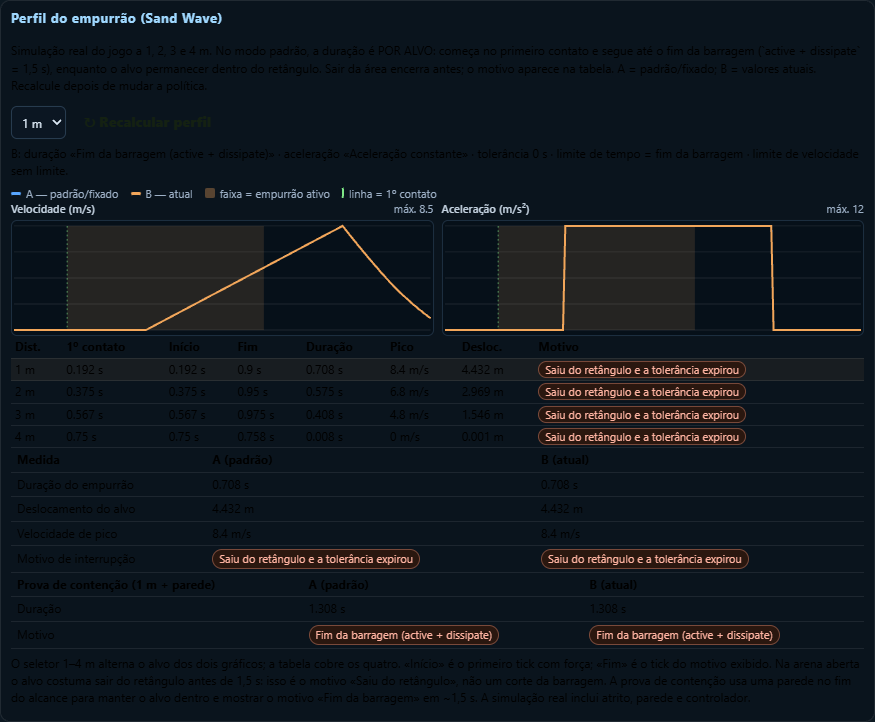

# DOC03 — Portão ZERO e melhorias do Editor de Moves (OpenCode)

**Data:** 26 de outubro de 2026
**Branch:** `feat/overhaul-sliders-moves` (worktree; rodada 6 sem commit)
**Worktree:** `.worktrees/overhaul-sliders-moves`
**Escopo:** Sand Wave, Bullet Punch e Water Pulse (3 pilotos)
**Veredito do Portão ZERO:** **FECHADO** — 173 candidatos, 173 decididos, 0 `OPEN`
**Veredito do DOC03 completo:** **NÃO HOMOLOGADO** — as melhorias avançadas do Editor ainda não foram entregues (ver §10)

---

## 1. Resultado em uma linha

A cobertura mecânica dos três pilotos deixou de ser medida por "quantidade de sliders" e passou a ser medida por **candidato mecânico classificado com consumidor real, controle/justificativa, persistência e evidência**. Todos os 173 candidatos têm decisão; nenhum sumiu nem ficou em aberto. A rodada 4 acrescentou 13 controles exclusivos do Sand Wave e 8 valores globais herdados de física/mundo; a rodada 5 acrescentou mais 12 controles de política do empurrão, todos com teste A/B individual, sem mexer nos padrões aprovados. A **rodada 6** mudou apenas o **tempo da força**: no modo oficial, o empurrão do Sand Wave começa no primeiro contato e dura até o **fim da barragem** (`active + dissipate` = **1,5 s**), enquanto o alvo permanecer dentro do retângulo; a janela de dano/cegueira continua em 0,75 s e não se repete.

| Métrica | Resultado | O que significa |
| :--- | ---: | :--- |
| Candidatos auditados | **173** | números, booleanos, enums, listas de colisão, flags, fórmulas e regras de IA |
| Decididos | **173 (100%)** | PASS + herdado + técnico justificado + bloqueado |
| Com A/B individual | **92 (53,2%)** | teste que muda o valor e observa efeito mecânico diferente |
| Herdados de sistema | **55** | vêm de Carga/Tackle/Combate/Física/Mundo/IA global, exibidos ao vivo no Editor |
| Técnicos justificados | **16** | invariante prova "mesma mecânica" ou "só aparência"; **nunca contam como PASS** |
| Bloqueados com justificativa | **10** | regras semânticas de IA (código, não dado) |
| Abertos | **0** | — |

> **Não existe "100% de cobertura" por contagem de sliders.** O número honesto é: **100% decidido** e **53,2% com prova A/B individual**. Os 46,8% restantes são herdados, técnicos ou bloqueados — cada um com motivo escrito e, quando aplicável, teste de invariante.

---

## 2. Método (o que foi auditado)

A unidade auditada é o **candidato**, não o literal: um número, booleano, enum, lista de colisão, flag ou fórmula que possa alterar o resultado mecânico do Move. Para cada candidato a matriz registra:

1. **Origem** — ficha `.move.json`, perfil de IA declarativo (`ficha.ai`), sistema compartilhado (`C.*`) ou código do motor.
2. **Tipo/escopo** — exclusivo, IA, herdado, técnico, bloqueado.
3. **Valor da ficha × valor efetivo em runtime** (a base de calibração v8 pode sobrepor).
4. **Fase de leitura** — ativação, cast, tick, hit, spawn, soltura, decisão.
5. **Consumidor** — `arquivo:função` que realmente lê o valor.
6. **Controle na UI** — slider + input exato, seção de IA, leitura explicada ou somente leitura.
7. **Persistência** — `.move.json`, configuração global ou sessão (IA).
8. **Herança** — exclusivo, herdado, "substituído por X".
9. **Evidência A/B** — teste nominal que prova o efeito (ou invariante, no caso técnico).
10. **Decisão** — `PASS`, `INHERITED`, `TECH-JUSTIFIED`, `BLOCKED` ou `OPEN`.

Há ainda um **detector de mutação**: um candidato novo sem classificação entra automaticamente como `OPEN` (teste `detector de mutação: candidato novo sem classificação entra como OPEN`). Ou seja, a matriz não pode "esquecer" um parâmetro novo.

Implementação: `prototypes/combat-lab/src/sim/moves/pilot-coverage.js` (puro, sem UI).
Consumidores: painel do Editor + `prototypes/combat-lab/test/moves-doc03-pilots.test.mjs` + testes de cada Move.

---

## 3. Matriz por Move

| Move | Candidatos | PASS A/B | Herdados | Técnicos | Bloqueados | Abertos | % decidida | % A/B |
| :--- | ---: | ---: | ---: | ---: | ---: | ---: | ---: | ---: |
| **Sand Wave** | 69 | 48 | 13 | 5 | 3 | 0 | 100% | 69,6% |
| **Bullet Punch** | 60 | 21 | 30 | 5 | 4 | 0 | 100% | 35,0% |
| **Water Pulse** | 44 | 23 | 12 | 6 | 3 | 0 | 100% | 52,3% |
| **Total** | **173** | **92** | **55** | **16** | **10** | **0** | **100%** | **53,2%** |

Composição por origem:

| Move | Exclusivos da ficha | IA declarativa (editável) | IA bloqueada | Herdados | Técnicos/políticas |
| :--- | ---: | ---: | ---: | ---: | ---: |
| Sand Wave | 45 | 3 | 3 | 13 | 5 |
| Bullet Punch | 18 | 3 | 4 | 30 | 5 |
| Water Pulse | 19 | 4 | 3 | 12 | 6 |

### 3.1 Sand Wave — PASS (48)

`cost`, `cooldown`, `cast`, `length`, `width`, `active`, `speedFromReach`, `waveSpeed`, `waveAccel`, `dissipate`, `damage`, `knockbackH`, `knockbackV`, `accel`, `pushSpeed`, `pushDuration`, `pushDurationMode`, `pushContinueAfterActive`, `pushContinuesOutsideArea`, `pushReleaseDelay`, `pushContinuesDuringStagger`, `pushPreserveVelocity`, `pushMaxSpeed`, `pushAccelerationMode`, `pushCurvePower`, `pushTargetSpeed`, `pushRampTime`, `pushClearsLocomotion`, `pushCancelsDodge`, `pushCancelsExistingDodge`, `partialFactor`, `blind`, `blindOnPartial`, `wallStagger`, `wallStaggerOn`, `visionRadius`, `detour`, `waveHeight`, `wallPressMinSpeed`, `wallPressMoveRatio`, `wallPressStopRatio`, `wallUnpinDistance`, `waveBottomTolerance`, `hitsAirborne`, `maxTargets`, `ai.p`, `ai.distance.max`, `ai.minStamina`.

### 3.2 Sand Wave — técnicos (5)

`fogDarkness` (só câmera/cegueira; invariante de hash), `cell` (resolução da grade; mesmo tick), `replanSteps` (intervalo de recálculo; mesmo tick), `perfectNullifiesBlind` (política de defesa perfeita), `oneHitPerTarget` (um acerto válido por alvo).

### 3.3 Bullet Punch — PASS (21)

`cost`, `cooldown`, `cast`, `vanish`, `reach`, `strikeReach`, `stopShort`, `hitRadius`, `impactMult`, `knockbackOwn`, `knockbackH`, `knockbackV`, `slow`, `maxRise`, `airReach`, `rayStep`, `freeSearchRadius`, `freeSearchStep`, `ai.p`, `ai.distance.min`, `ai.minStamina`.

### 3.4 Bullet Punch — técnicos (5)

`fxLines` (linhas de velocidade; só view), `fxHideBody` (corpo oculto; só view), `absentBody` (ausência mecânica durante o sumiço), `lockTarget` (alvo fixado na soltura), `firstSolid` (para no primeiro sólido; `rayStep` continua editável).

### 3.5 Bullet Punch — herdados (30)

2 de Carga (`boostStaminaPerSecond`, `boostStep`), **25 do Tackle** (`duration`, `cost`, `invulnerable`, `distance`, `curveStart`, `steerLimit`, `steerRate`, `blend`, `chainAfter`, `recovery`, `fromGuard`, `distanceReference`, `profile`, `fromRecoil`, `fromGuardStun`, `counterSpeed`, `prepTime`, `impulseTime`, `decelStart`, `recoveryTime`, `prepSpeed`, `travelEnd`, `selfCancel`, `guardCancel`, `perfectGuardCancel`), 2 de Combate (`guardDamageMultiplier`, `impactHitstop`) e 1 de IA global (`newMovesRate`). A enumeração é derivada de `C.actions.tackle`, não de uma lista fixa de 4 curvas.

### 3.6 Water Pulse — PASS (23)

`cost`, `cooldown`, `maxCharge`, `minCharge`, `chargeRecovery`, `damagePl1`, `damagePl2`, `damagePl3`, `knockbackPl1`, `knockbackPl2`, `knockbackPl3`, `knockbackV`, `speed`, `radius`, `range`, `originHeight`, `spawnForward`, `pierce`, `counterStagger`, `ai.p`, `ai.distance.min`, `ai.distance.max`, `ai.minStamina`.

### 3.7 Water Pulse — técnicos (6)

`plScaleBonus` (escala visual; raio físico intacto), `blockedBy` (para em barreira/parede), `clashable` (participa do clash), `lifeFormula` (vida derivada de alcance/velocidade), `speed3d` (direção 3D com velocidade escalar), `spawnRefundPolicy` (spawn bloqueado reembolsa e não cria entidade).

### 3.8 Bloqueados (10) — IA semântica, não slider

`ai.kind`, `ai.why`, `ai.requires` nos três pilotos; `ai.when` apenas no Bullet Punch. São regras de código (modalidade tap/charge/aim, texto de log, elegibilidade e predicado específico) e aparecem no Editor como **somente leitura explicada**, com justificativa na matriz.

---

## 4. O que cada decisão NÃO-PASS significa

- **INHERITED (55):** não é "cobertura grátis". O valor real do sistema é exibido ao vivo no Editor, com o caminho (`C.actions.tackle.prepTime`, `C.world.charge.recovery`, `C.locomotion.friction`, etc.), o consumidor e o aviso quando o Move o substitui. O Tackle não foi migrado.
- **TECH-JUSTIFIED (16):** ou o teste prova que o resultado mecânico é idêntico (hash/estado/tick), ou prova que o parâmetro só altera a camada visual. Por definição, **não entram no numerador de PASS**.
- **BLOCKED (10):** regras semânticas de IA. Alterá-las exigiria recompilar a regra e mudaria o contrato de leitura justa da IA; por isso ficam somente leitura, com texto no painel.

---

## 5. Novidades no Editor de Moves

Arquivo: `prototypes/combat-lab/src/editor/move-editor-panel.js` (+ `src/styles.css`)

1. **Seção "Portão ZERO: cobertura dos 3 pilotos"** (`#editor-coverage-sec`)
   - Barras de "Cobertura decidida" (100%) e "Evidência A/B individual" (53,2%).
   - Contagem de candidatos, PASS, herdados, técnicos e bloqueados.
   - Coluna **"Sliders"** por piloto (Sand Wave 64 · Bullet Punch 51 · Water Pulse 36; total 151), separando candidatos de controles reais: os demais candidatos são regras fixas ou campos bloqueados somente leitura.
   - Lista de `OPEN` (hoje vazia) com candidato e consumidor, caso apareça no futuro.
   - Divergências **ficha × padrão aprovado** em tabela (hoje 2).
2. **Seção "IA do Move"** (`#editor-ai-sec`)
   - Sliders + input numérico para chance (`p`), faixa de distância (`distance.min/max`) e stamina (`minStamina`/`maxStamina`), com efeito real na decisão da IA.
   - Botão "↺ Restaurar IA da ficha".
   - Campos semânticos (`kind`, `requires`, `when`, `why`) exibidos como leitura explicada.
   - O ajuste é **override de sessão**; o perfil de fábrica permanece idêntico.
3. **Herança completa** — a subseção de herdados passou a enumerar todos os campos numéricos do Tackle e de Carga/Combate/IA, com valor ao vivo e origem.
4. **Ctrl+K** — foco direto na busca de parâmetros do Editor (não rouba o atalho quando o foco já está num campo).
5. **Parâmetros antes sem controle na ficha**
   - `sand-wave.waveBottomTolerance` (padrão 0,2 m).
   - `water-pulse.pierce` (padrão 1, consumido pelo projétil real).
   - **Rodada 4 — Sand Wave:** `speedFromReach`, `waveSpeed`, `waveAccel`, `pushSpeed`, `pushDuration`, `pushClearsLocomotion`, `pushCancelsDodge`, `blindOnPartial`, `hitsAirborne`, `wallStaggerOn`, `wallPressStopRatio`, `wallUnpinDistance` e `maxTargets`. `accel` (empurrão) e `partialFactor` foram movidos para a categoria **Knockback**; `accel`, `waveSpeed`, `pushSpeed` e `pushDuration` aparecem no filtro **Essencial**, para não ficarem escondidos atrás de "Avançado".
   - **Rodada 4 — herdados do Sand Wave:** `locomotion.friction`, `locomotion.accelCurve`, `locomotion.brakeCurve`, `locomotion.residualSpeed`, `rules.launchGravity`, `rules.launchDrag`, `extras.toggles.enableLaunch` e `world.maxEntities`.
6. **Consumidor declarado na ficha** para `sand-wave.fogDarkness`, `bullet-punch.fxLines` e `bullet-punch.fxHideBody`.
7. **Rodada 5 — Perfil do empurrão do Sand Wave** (`#editor-push-profile`, só nesse Move)
   - Roda a **simulação real** (`Game` + `prepareScenario` + `makeMoveScenario`) a **1, 2, 3 e 4 m**, com os valores A (padrão/fixado) e B (atuais), não uma fórmula decorativa.
   - Gráficos SVG de **velocidade** e **aceleração** por tick, com faixa do empurrão ativo, linha do 1º contato e legenda A/B.
   - Tabela por alvo com **1º contato, início, fim, duração, velocidade de pico, deslocamento e motivo de interrupção**.
   - **Prova de contenção** (1 m + parede no fim do alcance): mantém o alvo dentro do retângulo e mostra o motivo **Fim da barragem** em ~1,5 s; sem a parede, a arena aberta termina em **Saiu do retângulo**.
   - Comparação A/B da distância selecionada (duração, deslocamento, pico e motivo) e botão **↻ Recalcular perfil**.
   - `sand-push-trace.js` exporta `traceSandPush`, `traceSandPushPair`, `svgPoints` e `svgPushBand`; a telemetria é reutilizável por testes. A opção `containment` usa a arena `backwall` para a prova de contenção.
8. **Rodada 5/6 — 12 controles novos do empurrão** (todos na categoria **Knockback**, exceto `pushPreserveVelocity` em **Movimentação**):
   - `pushDurationMode` (`<select>` **Duração do empurrão**: 0 = fim da barragem (padrão), 1/2 experimentais, 3 = janela de dano legada).
   - `pushContinueAfterActive` (só modo legado 3: continua depois de `active`).
   - `pushDuration` (**Limite de tempo**: 0 = acompanha a política; no modo 0 é um teto opcional, nunca prolonga além da barragem).
   - `pushContinuesOutsideArea`, `pushReleaseDelay`, `pushContinuesDuringStagger` (padrão **1** — stagger de parede não desliga a força).
   - `pushPreserveVelocity`, `pushMaxSpeed`.
   - `pushAccelerationMode` (`<select>`: constante / curva temporal / velocidade-alvo), `pushCurvePower`, `pushTargetSpeed`, `pushRampTime`.
   - `pushCancelsExistingDodge` (interrompe esquiva em andamento; separado de `pushCancelsDodge`, que só bloqueia a nova).
   - `dissipate` voltou para **Área e persistência** na seção Mecânica, para não ficar inacessível ao sair do filtro visual.

---

## 6. Evidência A/B individual (novos testes)

Arquivos: `prototypes/combat-lab/test/moves-doc03-pilots.test.mjs` (18 testes) e `prototypes/combat-lab/test/moves-sand-push.test.mjs` (**18 testes**). Deltas observados:

| Candidato | Teste | Efeito medido |
| :--- | :--- | :--- |
| `sand-wave.waveBottomTolerance` | `waveBottomTolerance` | 0,2 m alcança alvo 15 cm acima (hp cai + cegueira); 0,05 m não alcança (hp 100, sem cegueira) |
| `sand-wave.speedFromReach` / `waveSpeed` | `sincronização, velocidade manual e aceleração da frente` | sincronizado ignora 0,5 e 20 m/s (mesmo tick); manual 0,5 m/s não alcança 3 m; manual 20 m/s acerta antes |
| `sand-wave.waveAccel` | idem | aceleração 10 m/s² obriga v₀ menor e atrasa a chegada em >5 ticks |
| `sand-wave.pushSpeed` | `impulso, duração, limpeza e cancelamento do empurrão` | 0 → 0 m/s; 8 → >7,9 m/s na locomoção do alvo; defesa perfeita → 0; parcial → 4 m/s |
| `sand-wave.pushDuration` | idem | 0,1 s desliga o empurrão contínuo após 0,11 s; 0 = usa a política. No modo oficial, um valor >0 é teto e não prolonga além da barragem |
| `sand-wave.pushDurationMode` | `duração por alvo independente` | modo 0 (oficial) mantém a força depois de `active` e termina em 1,5 s (`barrageEnded`); modo 1 mantém 0,40 s a 1, 2, 3 e 4 m; modo 3 reproduz a janela de dano legada |
| `sand-wave.pushContinueAfterActive` | `modo oficial: active não encerra...` | só o modo legado 3 usa: sem continuidade registra `activeWindowEnded`; com continuidade segue em 1,6 s |
| `sand-wave.pushContinuesOutsideArea` | `limite opcional e saída do retângulo` | 0 para ao sair (`leftArea`) no modo oficial; 1 mantém a força até a duração/janela |
| `sand-wave.pushReleaseDelay` | `fora do retângulo + tolerância` | 0,05 s de tolerância mantém por 2 ticks; 0 para no primeiro tick sem contato |
| `sand-wave.pushContinuesDuringStagger` | `continua durante stagger/recuperação` + `parede` | 0 registra `recovery`/`wallStagger`; 1 mantém a força mesmo com `knockRecovery`, e a parede física continua impedindo a passagem |
| `sand-wave` — fim da barragem | `parede: stagger não desliga...` | alvo a 3,2 m com parede em 4 m recebe força até ~1,49 s e termina em `barrageEnded`; a parede limita a posição |
| `sand-wave` — inércia final | `velocidade adquirida sobrevive...` | ao sair do retângulo, a velocidade não é zerada no mesmo tick; o motor desacelera normalmente |
| `sand-wave` — acerto único | `permanência na área não repete...` | HP e cegueira ficam iguais após permanecer dentro até 1,4 s; só 1 evento `blinded` |
| `sand-wave.pushPreserveVelocity` | `preserva velocidade própria` | 1 conserva 100% da velocidade lateral; 0 zera junto com a limpeza |
| `sand-wave.pushMaxSpeed` | `limite de velocidade do empurrão` | 2 m/s corta a componente do empurrão; 0 não limita |
| `sand-wave.pushAccelerationMode` | `modos de aceleração` | 0 constante; 1 curva temporal; 2 velocidade-alvo converge em ~0,7 s |
| `sand-wave.pushCurvePower` | idem | potência 0,5 e 3 mudam a forma da curva no mesmo intervalo |
| `sand-wave.pushTargetSpeed` | idem | alvo 1 m/s e 9 m/s mudam a velocidade final |
| `sand-wave.pushRampTime` | idem | 0,2 s ≈ 63% da convergência; 1,0 s ≈ 63% em 1 s |
| `sand-wave.pushCancelsExistingDodge` | `esquiva existente vs. nova` | 1 interrompe a esquiva em andamento; 0 mantém a ação |
| `sand-wave.pushClearsLocomotion` | idem | 1 zera a velocidade própria (0); 0 conserva −5 m/s |
| `sand-wave.pushCancelsDodge` | idem | 1 bloqueia **nova** esquiva; 0 permite. A esquiva já em andamento é controlada por `pushCancelsExistingDodge` |
| `sand-wave.blindOnPartial` | `cegueira na parcial, alvo aéreo, stagger e limite de alvos` | ambos recebem dano parcial; 1 cega, 0 não cega |
| `sand-wave.hitsAirborne` | idem | 0 ignora alvo em voo baixo; 1 acerta |
| `sand-wave.wallStaggerOn` | idem | 1 gera 1 stagger; 0 gera 0 |
| `sand-wave.wallPressStopRatio` | idem | 0,3 reconhece intenção zerada como parede; 0 não dispara |
| `sand-wave.wallUnpinDistance` | idem | 1 cm solta com 20 cm de deslocamento; 0,5 m permanece prensado |
| `sand-wave.maxTargets` | idem | 1 atinge só um alvo; 2 atinge os dois |
| `sand-wave` herdados de física/mundo | `Herança do Sand Wave` | física/lançamento/maxEntities expostos; `maxEntities` 1 recusa a barragem, 2 permite; fórmulas v₀/v_f usam `waveAccel` |
| `sand-wave.knockbackV` | `knockbackV, accel, wallStagger e visionRadius` | V=0 → altura 0; V=6 → >0,3 m de voo |
| `sand-wave.accel` | idem | accel 0 → <0,3 m de empurrão; accel 30 → >1,5 m |
| `sand-wave.wallStagger` | idem | evento carrega 0,1 s / 0,8 s; recuperação <0,2 / >0,7 |
| `sand-wave.visionRadius` | idem | raio 4 m não vê alvo a 6 m; raio 12 m vê |
| `sand-wave.detour` | `detour decide o desvio` | detour 0,3 m não contorna parede larga; 10 m contorna e acerta |
| `sand-wave.wallPressMinSpeed` | `wallPressMinSpeed e wallPressMoveRatio` | limiar 0,1 → 1 stagger; limiar 100 → 0 |
| `sand-wave.wallPressMoveRatio` | idem | razão 0,25 → 0 staggers (frenagem de 50%) |
| `water-pulse.pierce` | `pierce sai da ficha para o projétil real` | ficha 1 → projétil `pierce=1`; ficha 2 → `pierce=2` |
| `bullet-punch.cost` / `cooldown` | `custo, cooldown, slow, knockback` | custo 3 cobrado; cooldown 20 iniciado |
| `bullet-punch.slow` | idem | slow 0,7 anda >0,2 m menos que slow 0 |
| `bullet-punch.knockbackOwn/H/V` | idem | H=10 empurra >3 m a mais que H=2; `knockbackOwn` difere da fórmula do Tackle; V=8 lança >0,2 m |
| `bullet-punch.maxRise` | idem | maxRise 0 → não sobe plataforma; 6 → apoia em 2,5 m |
| `bullet-punch.freeSearchRadius` / `Step` | `freeSearchRadius e freeSearchStep` | raio muda o ponto de chegada; passo 0,05 fica mais perto do destino que 1 |
| `water-pulse.chargeRecovery` | `chargeRecovery, originHeight, spawnForward...` | recuperação 0,1/0,8 segue o slider (±0,02) |
| `water-pulse.originHeight` / `spawnForward` | idem | altura 0,3/1,2 exata; spawn 1,4 nasce >0,8 m à frente do 0,3 |
| `water-pulse.knockbackV` | idem | V=0 → 0; V=8 → >0,3 m |
| `water-pulse.counterStagger` | idem | evento carrega 0,2 s / 0,7 s exatos |
| `sand-wave.cell` | `cell, replanSteps e fogDarkness` | cell 0,1 e 0,5 acertam no mesmo tick |
| `sand-wave.replanSteps` | idem | replanSteps 1 e 60 acertam no mesmo tick |
| `sand-wave.fogDarkness` | idem | hash mecânico idêntico com 0,2 e 0,9 |
| `bullet-punch.fxLines` / `fxHideBody` | `Visual isolado` | hash mecânico idêntico ligado/desligado |
| `water-pulse.plScaleBonus` | idem | `visualScale` muda; `radius`, dano, knockback e hash iguais |
| IA declarativa | `override do Editor muda a decisão` | override reduz alcance (3 m deixa de decidir, 1,5 m decide); restaurar volta ao perfil da ficha |
| Herança do Tackle | `Herança completa do Tackle` | todos os campos numéricos de `C.actions.tackle` aparecem como herdados no Bullet Punch |

### 6.1 Simulação real no navegador (Editor → Perfil do empurrão)

Medição feita no Editor do `dist/` por `file://` com a seção **Perfil do empurrão** (não é fórmula decorativa: é `Game.step` a 120 Hz com controlador, atrito e colisão). O seletor 1–4 m alterna o alvo dos dois gráficos; a tabela cobre os quatro alvos. A **prova de contenção** usa 1 m + parede no fim do alcance (arena `backwall`) para o alvo permanecer no retângulo e comprovar o fim da barragem.

**Padrão oficial (modo 0, `pushDuration=0`, `pushContinuesDuringStagger=1`, `pushContinuesOutsideArea=0`):**

| Distância | 1º contato | Início | Fim | Duração | Vel. pico | Deslocamento | Motivo |
| ---: | ---: | ---: | ---: | ---: | ---: | ---: | :--- |
| 1 m | 0,192 s | 0,192 s | 0,900 s | **0,708 s** | 8,4 m/s | 4,432 m | Saiu do retângulo (`leftArea`) |
| 2 m | 0,375 s | 0,375 s | 0,950 s | **0,575 s** | 6,8 m/s | 2,969 m | Saiu do retângulo (`leftArea`) |
| 3 m | 0,567 s | 0,567 s | 0,975 s | **0,408 s** | 4,8 m/s | 1,546 m | Saiu do retângulo (`leftArea`) |
| 4 m | 0,750 s | 0,750 s | 0,758 s | **0,008 s** | 0,0 m/s | 0,001 m | Saiu do retângulo (`leftArea`) |

A duração **não** é mais o resto de `active`: a força acompanha a barragem. Na arena aberta o alvo é empurrado para fora do retângulo antes de 1,5 s; por isso o motivo é `leftArea`. O fim da barragem é comprovado com contenção:

| Prova de contenção (1 m + parede) | A (padrão) | B (atual) |
| :--- | ---: | ---: |
| Início / fim | 0,192 s / **1,500 s** | 0,192 s / **1,500 s** |
| Duração | **1,308 s** | **1,308 s** |
| Pico / deslocamento | 1,8 m/s / 0,150 m | 1,8 m/s / 0,150 m |
| Motivo | **Fim da barragem (`barrageEnded`)** | **Fim da barragem (`barrageEnded`)** |

A duração de 1,308 s é contada do **primeiro contato** (0,192 s) até o fim da barragem (1,5 s). Do disparo até o fim são 1,5 s. O alvo a 1 m anda 0,15 m, bate na parede, entra em stagger e continua recebendo a força até o fim; a parede impede a passagem.

**Modo 1 experimental (tempo fixo de 0,40 s desde o contato; `pushContinuesOutsideArea=1` para o alvo não sair da área antes de cumprir a janela):**

| Distância | 1º contato | Início | Fim | Duração | Vel. pico | Deslocamento | Motivo |
| ---: | ---: | ---: | ---: | ---: | ---: | ---: | :--- |
| 1 m | 0,192 s | 0,192 s | 0,600 s | **0,408 s** | 4,8 m/s | 1,337 m | Duração configurada cumprida (`durationElapsed`) |
| 2 m | 0,375 s | 0,375 s | 0,783 s | **0,408 s** | 4,8 m/s | 1,337 m | Duração configurada cumprida (`durationElapsed`) |
| 3 m | 0,567 s | 0,567 s | 0,975 s | **0,408 s** | 4,8 m/s | 1,337 m | Duração configurada cumprida (`durationElapsed`) |
| 4 m | 0,750 s | 0,750 s | 1,158 s | **0,408 s** | 4,8 m/s | 1,337 m | Duração configurada cumprida (`durationElapsed`) |



> **Nuance do 4 m na arena aberta:** o alvo chega no último tick de `active` e sai do retângulo no tick seguinte (`leftArea`, 0,008 s). Com `pushContinuesOutsideArea=1` ou contenção, a força pode cumprir a duração. O perfil mostra o motivo exato por alvo justamente para não esconder essa diferença.

Motivos implementados e exibidos: `barrageEnded` (**fim da barragem, oficial**), `activeWindowEnded` (legado), `durationElapsed`, `leftContact`, `leftArea`, `releaseGrace`, `airborne`, `verticalOut`, `wallStagger`, `recovery`, `targetGone`, `perfectGuard`, `superseded`, `waveGone`, `inactive`. Com `pushContinuesDuringStagger=0`, `wallStagger` tem prioridade sobre `recovery`; com o padrão **1**, o stagger de parede não interrompe a força. `pushReleaseDelay` cobre perda momentânea de contato; múltiplas ondas: maior aceleração vence e a perdedora registra `superseded`. No modo 0, `pushContinueAfterActive` é ignorado; ele só controla o modo legado 3.

---

## 7. Divergência ficha × runtime (exibida, não escondida)

A base de calibração v8 sobrepõe dois valores do Bullet Punch. O Editor mostra a divergência na seção do Portão ZERO:

| Candidato | Ficha `.move.json` | Runtime aprovado (v8) |
| :--- | ---: | ---: |
| `bullet-punch.cast` | 0,75 s | **0,2 s** |
| `bullet-punch.impactMult` | 1,0 | **2,6** |

Nenhum dos dois foi "corrigido" na ficha: o valor aprovado do jogo é o de runtime, e a ficha continua documentando o valor de projeto. O teste A/B usa o runtime.

---

## 8. Arquivos alterados nesta entrega

| Arquivo | Mudança |
| :--- | :--- |
| `src/sim/moves/pilot-coverage.js` | matriz, evidência, técnicos, políticas, derivação de runtime e resumo |
| `src/sim/moves/sand-wave/sand-push.js` | **novo** — política pura do empurrão por alvo, 4 modos de duração (0 = fim da barragem), aceleração, motivos, disputa entre ondas e integração de velocidade |
| `src/editor/sand-push-trace.js` | **novo** — telemetria real do empurrão (1–4 m + contenção com parede), amostras por tick, séries SVG e faixa do empurrão |
| `test/moves-sand-push.test.mjs` | **novo** — 18 testes A/B da política por alvo, barragem, parede/pinned, inércia, acerto único, motivos, esquiva, múltiplas ondas (incluindo empate) e fórmulas |
| `test/moves-doc03-pilots.test.mjs` | 18 testes DOC03 (A/B + invariantes + mutação + herança + IA) |
| `test/moves-pilots-baseline.test.mjs` + `docs/overhaul-pilotos/baseline_sand-wave.json` | paridade determinística com o baseline do Sand Wave atualizado para o novo deslocamento (posição final +0,772 m) |
| `src/editor/move-editor-panel.js` | seções "IA do Move", "Portão ZERO" e **"Perfil do empurrão"** com coluna **Fim** e **prova de contenção**, herança completa, Ctrl+K, fórmulas calculadas corrigidas |
| `src/styles.css` | barras de cobertura, grade da seção de IA e gráficos/legenda do perfil do empurrão |
| `src/sim/ai-profile.js` | API de override por Move (validada; restauração ao padrão) |
| `src/sim/moves/move-mechanics-audit.js` | enumeração completa de herdados (Tackle/Carga/Combate/Física/Mundo/IA), herança do Sand Wave, fórmulas v₀/v_f/frente, painel de empurrão com **modo 0 = fim da barragem** e `partialFactor` como dano de guarda |
| `src/sim/moves/params-registry.js` | categorias/consumidores/`options`/`noDouble` dos controles novos; `dissipate` em Área e persistência |
| `src/sim/moves/sand-wave/sand-wave.move.json` | `waveBottomTolerance`, 13 controles da rodada 4 e **12 controles de política do empurrão**; modo 0 = fim da barragem, `pushDuration` como teto, `pushContinuesDuringStagger=1` |
| `src/sim/moves/sand-wave/sand-wave.js` | captura de `speed0`/`waveAccel` e de todos os controles de empurrão/alvo no disparo; fallback de stagger alinhado ao padrão 1 |
| `src/sim/sand.js` | `sandFrontAt` (v₀·t + ½·a·t²), passo do empurrão por alvo, contato/área/tolerância, limpeza/preservação, stagger, disputa entre ondas e vida estendida **só nos modos experimentais**; no modo 0 a onda não é esticada |
| `src/sim/controller/ctrl-update.js` | aplica o empurrão durante `knockRecovery`/stun quando `pushContinuesDuringStagger=1` |
| `src/sim/controller/ctrl-basico.js` | bloqueio de esquiva sob `sandPush` respeita `pushCancelsDodge`; `pushCancelsExistingDodge` interrompe a esquiva em andamento |
| `src/sim/world.js` | solta o alvo e registra `waveGone` quando a onda é removida com empurrão ativo |
| `src/ui/moves-panel.js` | `<select>` para modos e `dissipate` de volta à Mecânica |
| `src/view/collision-overlays.js` | overlay da frente usa `sandFrontAt` |
| `src/view/world-view/wv-update.js` | VFX da frente usa `sandFrontAt` |
| `src/sim/moves/bullet-punch/bullet-punch.move.json` | consumidores de `fxLines` e `fxHideBody` |
| `src/sim/moves/water-pulse/water-pulse.move.json` | `pierce` + consumidor de `plScaleBonus` |
| `src/sim/moves/water-pulse/water-pulse.js` | `pierce` lido da ficha (`Math.max(1, Math.round(...))`) |
| `docs/AUDITORIA_SLIDERS_MECANICOS_MOVES.md` | Rodada 4/5 do Sand Wave e números do Portão ZERO atualizados; consumidor do limite de tempo corrigido |
| `docs/PLANO_EDITOR_DE_MOVES.md` | status e inventário atualizados |
| `docs/MUSHROOM_MOVES_DECISOES.md` | revisão de 26/10/2026: força até o fim da barragem, janela de dano separada, stagger não desliga e inércia preservada |
| `ABRIR_ARENAMON.html` | links deste relatório nos grupos "Moves e colisão" (evidências) e "Moves" (documentação) |
| `TESTES_ARENAMON.html` | card do Portão ZERO com o comando do teste DOC03 e link do relatório |
| `HTMLS_ARENAMON.html` | atalho para o relatório na lista de HTMLs e diagnósticos |

> `docs/INDICE_VIVO_MOVES.md` foi regenerado por `npm run indice` no worktree durante a sessão e já lista `pilot-coverage.js`, o teste DOC03 e este relatório. A correção de caminho em `prototypes/combat-lab/gen-indice.mjs` que acompanha essa regeneração **não é desta entrega**.

> `scripts/typecheck-vfx.mjs`, `scripts/typecheck-vfx.test.mjs` e a entrada `test:typecheck-vfx` do `package.json` já estavam modificados no worktree e **não fazem parte do DOC03**; não foram alterados por esta entrega.

Nesta rodada, nada foi commitado, enviado ou mesclado. O trabalho segue **não commitado** em `.worktrees/overhaul-sliders-moves`; os commits anteriores de endurecimento (`5cb8219`, `08b39cc`) já estavam na branch antes desta rodada.

---

## 9. Como abrir e testar

No worktree:

- Jogo: `.worktrees/overhaul-sliders-moves/JOGAR_ARENAMON.html`
- Estúdio/Editor: `.worktrees/overhaul-sliders-moves/EDITOR_DE_MOVES.html` (ou o atalho "Estúdio de Moves" no portal)
- Portal: `.worktrees/overhaul-sliders-moves/ABRIR_ARENAMON.html`
- Central de Testes: `.worktrees/overhaul-sliders-moves/TESTES_ARENAMON.html` (card "Portão ZERO — Cobertura Mecânica dos 3 Pilotos")
- Índice rápido: `.worktrees/overhaul-sliders-moves/HTMLS_ARENAMON.html`
- No Editor, role até **"Perfil do empurrão (Sand Wave)"**, **"Portão ZERO: cobertura dos 3 pilotos"** e **"IA do Move"**. Use **Ctrl+K** para focar a busca de parâmetros.
- No Perfil, escolha 1–4 m, mexa nos controles de empurrão e clique em **↻ Recalcular perfil**. A simulação roda no próprio navegador (sem servidor de teste).

Build: `node prototypes/combat-lab/build.mjs` (ou `npm run build:combat-lab`).
Typecheck do laboratório: `node node_modules/typescript/bin/tsc --noEmit -p prototypes/combat-lab/tsconfig.json` (sem erros).

Testes executados nesta rodada (todos verdes):

```
node prototypes/combat-lab/test/moves-sand-push.test.mjs         # 18 testes
node prototypes/combat-lab/test/moves-doc03-pilots.test.mjs      # 18 testes
node prototypes/combat-lab/test/moves-sand-wave.test.mjs          # 24 testes
node prototypes/combat-lab/test/move-editor.test.mjs              # 16 + 17 verificações
node prototypes/combat-lab/test/move-editor.browser.mjs           # 41 verificações no dist (file://)
node prototypes/combat-lab/test/moves-mechanics-audit.test.mjs    # 4 testes
node prototypes/combat-lab/test/moves-fichas.test.mjs             # 6 testes
node prototypes/combat-lab/test/moves-params.test.mjs             # 11 verificações
```

Validação no navegador (automática, `file://` no `dist/`): seção "Perfil do empurrão" presente; `<select>` de duração com **4 modos** (0 = fim da barragem; 1 e 2 experimentais; 3 legado) e de aceleração com os 3 modos; `dissipate` acessível; tabela 1–4 m com coluna **Fim**, **prova de contenção** e os dois gráficos SVG renderizados; valores de padrão e de modo 1 conferidos (tabelas em §6.1). O `dist/` é recompilado ao final para abrir por arquivo.

Também verdes: `node scripts/rapido.mjs --sem-cache` (**160/160**; alguns testes instáveis sob carga passaram na 2ª tentativa), `npm run build:combat-lab`, `npx tsc --noEmit -p prototypes/combat-lab/tsconfig.json`, `node scripts/estrito.mjs` e `node scripts/typecheck-vfx.mjs`. O baseline determinístico do Sand Wave foi atualizado (posição final +0,772 m) e o teste de paridade dos 3 pilotos passou 5/5.

---

## 10. Limitações e pendências (por que o DOC03 geral não está homologado)

O **Portão ZERO está fechado**, mas o documento DOC03 também pede melhorias avançadas de Editor que **não** foram entregues nesta etapa:

1. Arrastar no palco 3D com gizmos (posição/altura/ângulo) e validação visual correspondente.
2. Fantasma A/B visual lado a lado (comparar duas configurações em tela).
3. Linha do tempo com passo a passo e marcadores (bookmarks).
4. Presets nomeados, desfazer/refazer e cenários salvos.
5. Exportação de relatório por Move direto do Editor.
6. Teste E2E **WebGL pixel a pixel** do jogo. A seção Perfil, os `<select>`, a tabela, a prova de contenção e os SVG agora têm teste automatizado de navegador (`move-editor.browser.mjs`); falta a validação visual do render 3D.
7. `npm run verify` completo (a bateria longa de IA/propriedades não foi executada nesta sessão).

Também não foram verificados nesta etapa:

- WebGL/render 3D em telas pequenas — a estrutura DOM/SVG e a captura do Perfil foram validadas no navegador, mas não houve inspeção pixel a pixel do jogo.
- Persistência em disco dos ajustes de IA — por decisão de projeto, o override é de sessão; a ficha é código.
- Migração dos outros 16 Moves (fora de escopo por decisão; o Tackle permanece intocado).
- Commit, push, merge ou PR: **bloqueados até autorização expressa**; todo o trabalho está não versionado no worktree.

**Conclusão:** cobertura mecânica dos 3 pilotos auditada e fechada; Editor melhorado no que o Portão ZERO exigia; DOC03 completo permanece **NÃO HOMOLOGADO** até a entrega dos itens avançados acima.
