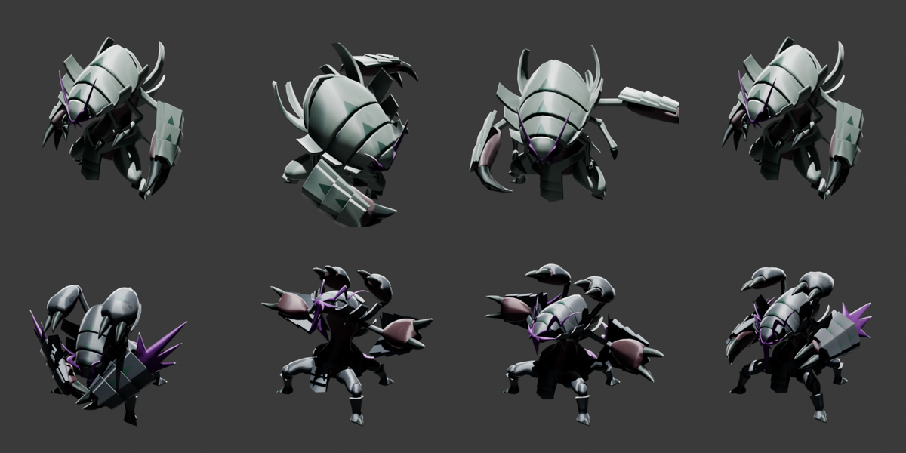

# Extrator Pokémon Legends: Z-A → Blender

Serve para estudar as animações originais: modelo, esqueleto, texturas e todos os clipes de um Pokémon num `.blend`.

## Como usar

1. Dê duplo clique em [`tools/za-extrator/EXTRAIR_POKEMON_ZA.bat`](../../tools/za-extrator/EXTRAIR_POKEMON_ZA.bat).
2. Digite o número da **Pokédex Nacional** (768 = Golisopod, 25 = Pikachu, 448 = Lucario).
3. Leva cerca de 20 s. A pasta `dumper test/blender/` abre sozinha, com um `.blend` por forma (ex.: `pm0867_00_00.blend` é o normal e `pm0867_51_00.blend` é o Mega).

No Blender, cada animação é uma **Action** com o nome do clipe (`00400_attack01`, `00030_walk01_loop`...). Para estudar, troque a Action no Action Editor do Dope Sheet ou use as faixas do NLA, que vêm mutadas, uma por clipe. O arquivo abre com a idle ativa.

## Onde ficam as coisas (nada disso vai para o Git)

| O quê | Onde |
|---|---|
| Dump do RomFS (Eden, Full) | `dumper test/romfs/arc/data.trpfd` + `data.trpfs` |
| DLL Oodle + Trinity File Explorer + PokeDocs | `dumper test/` |
| Arquivos crus extraídos + PNG das texturas | `dumper test/extraido/ik_pokemon/data/pmXXXX/` |
| `.blend` prontos | `dumper test/blender/` |

`dumper test/` está no `.gitignore` porque tem mais de 5 GB.

## Peças

- `tools/za-extrator/extrair_za.py`: lê TRPFD/TRPFS/TRPAK e descomprime com Oodle (a mesma lógica do Trinity File Explorer, sem janela).
- `tools/za-extrator/bntx_para_png.py`: converte as texturas BNTX (swizzle do Tegra + BC4/BC5/BC7) em PNG.
- `tools/za-extrator/montar_blend.py`: roda num Blender separado, em segundo plano, e usa o addon **Pokémon Switch V3** (ChicoEevee), instalado em `%APPDATA%/Blender Foundation/Blender/5.2/scripts/addons/PokemonSwitchV3`, com o `flatbuffers` instalado no Python do Blender.
- `tools/za-extrator/pokemon_za.py`: faz as três etapas em sequência. É ele que o `.bat` chama.

## Armadilha: o número da pasta não é o da Pokédex

No Z-A, a pasta `pmXXXX` **não** é o número da Pokédex. O Golisopod (#768) fica em `pm0867`; `pm0768` é o Xerneas. O extrator resolve isso lendo o catálogo do jogo (`ik_pokemon/catalog/catalog/poke_resource_table.trpmcatalog`).

## Conferência (Golisopod, 25/10/2026)

- Forma normal: 75 ossos e 115 animações, todas importadas sem falha. Mega: 141 ossos e 40 animações.
- 20 texturas convertidas por forma. O albedo é quase branco de propósito: a cor vem das máscaras `lym` do shader do addon.

**Não verificado:**
- Se as cores ficam idênticas às do jogo.
- Root motion: a walk anda para frente.
- Curvas `.trcrv` e efeitos `.traef`, que o addon não importa.
- Outros Pokémon além do Golisopod.
